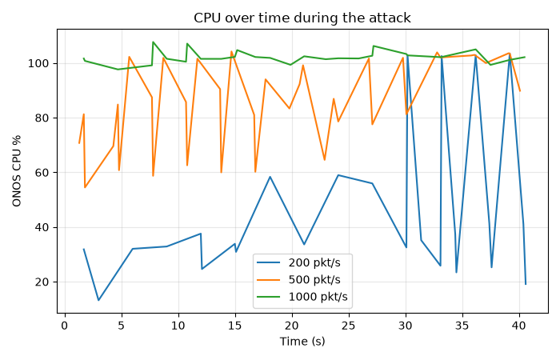

# SDN Controller Saturation Attacks — Group 2

Implementation and analysis of a **control-plane saturation attack** (Packet-In
flooding) against a resource-limited **ONOS** controller, plus two
countermeasures — **blocking** vs. **rate-limiting** — evaluated on their impact
and their effect on legitimate traffic.

> Course: *Security of Software Defined Networking*.

## Research question

As the Packet-In flooding rate increases against a CPU-limited ONOS controller,
**at what rate does the controller start to degrade, what breaks first**
(CPU, RAM, control-plane responsiveness, data-plane latency), and **how do
blocking and rate-limiting compare** at reducing the impact without harming
legitimate traffic?

## Threat model

- One malicious host inside the network sends a flood of packets with **fake,
  random source IP/MAC** addresses.
- Every packet looks like a brand-new flow, so the switch sends a new **Packet-In**
  to ONOS.
- At a high enough rate the ONOS CPU saturates and the control plane can no
  longer serve the network.
- We study **only control-plane (resource) saturation** — we do *not* flood the
  data links.

## Topology

```
          ONOS (Docker, CPU-limited)
                 |  OpenFlow 1.3 (tcp/6653)
              [ s1 ]  Open vSwitch
             /   |   \
          h1    h2    h3
       server  client  attacker
       (port1) (port2) (port3 = s1-eth3)
```

- **h1** — legitimate server.
- **h2** — legitimate client (the victim we measure: steady ping + loss).
- **h3** — attacker, runs the Scapy flood.

## Repository layout

| File | Role |
|------|------|
| `start_onos.sh` | Launch a **CPU-limited** ONOS in Docker and activate `openflow` + `fwd` (reactive forwarding). |
| `topology.py` | Mininet network (h1/h2/h3 + s1), for the live demo. |
| `flood.py` | Scapy attack: random src MAC/IP → one Packet-In per packet. Runs in `h3`. |
| `legit.py` | Victim workload in `h2`: steady ping RTT + loss. |
| `monitor.py` | Samples ONOS CPU%, RAM and REST-API latency → CSV. |
| `block.py` | Countermeasure 1 — DROP everything from the attacker's ingress port. |
| `ratelimit.py` | Countermeasure 2 — cap the attacker's port to N pkt/s with an ONOS meter. |
| `onoslib.py` | Tiny ONOS REST helper (stdlib only). |
| `run_experiment.py` | Automated driver: all scenarios, 3 repetitions, writes `results/*.csv`. |
| `plot.py` | Turns the CSVs into `summary.csv` + 8 figures. |
| `results/` | Collected CSVs and generated figures. |

## Prerequisites

- Linux host with **Mininet + Open vSwitch**, **Docker**, **Python 3**, **Scapy**.
- `plot.py` additionally needs `pandas` + `matplotlib`.

```bash
sudo apt install -y mininet openvswitch-switch python3-scapy docker.io curl
pip install pandas matplotlib
docker pull onosproject/onos:2.7-latest
```

## Two design decisions (worth defending)

1. **Blocking is by ingress PORT, not source IP/MAC.** The attacker randomises
   its source on every packet, so there is no stable source address to match —
   the only stable identifier is the switch port the attacker sits on.
2. **Rate-limiting uses an ONOS meter** (the SDN-native way). If your OVS build
   does not honor OF1.3 meters, enforce the same cap in the datapath with OVS
   ingress policing (see *Known issues*).

---

## How to run (live demo)

### 1. Start ONOS — **first**, and wait until it is fully ready
```bash
sudo mn -c
sudo ./start_onos.sh
```
**Checkpoint:** REST must answer (not 503) *and* the OpenFlow app must be `ACTIVE`:
```bash
curl -u onos:rocks http://localhost:8181/onos/v1/devices           # -> {"devices":[]}
curl -s -u onos:rocks http://localhost:8181/onos/v1/applications/org.onosproject.openflow \
  | grep -o '"state":"[A-Z]*"'                                      # -> "ACTIVE"
```
If the state is `INSTALLED`, activate and wait:
```bash
curl -u onos:rocks -X POST http://localhost:8181/onos/v1/applications/org.onosproject.openflow/active
curl -u onos:rocks -X POST http://localhost:8181/onos/v1/applications/org.onosproject.fwd/active
sleep 10
```

### 2. Start the network — **only after** ONOS is ready
```bash
sudo python3 topology.py --controller 127.0.0.1
```
**Checkpoint:**
```
mininet> sh curl -s -u onos:rocks http://localhost:8181/onos/v1/devices   # of:0000000000000001
mininet> pingall                                                          # 0% dropped
```

### 3. Observe + attack
```bash
sudo python3 monitor.py --name onos --scenario demo        # side terminal
```
In the Mininet CLI (`&` keeps the prompt free):
```
mininet> h2 python3 legit.py --server 10.0.0.1 --scenario demo &
mininet> h3 python3 flood.py --iface h3-eth0 --dst-ip 10.0.0.1 --rate 500 --duration 120 &
```

### 4. Apply the countermeasures (attacker = port 3)
```bash
python3 block.py --port 3 --install        # /  --remove
python3 ratelimit.py --port 3 --rate 150 --install   # /  --remove
```

### 5. Teardown
```
mininet> h2 pkill -f legit.py
mininet> exit
```
```bash
sudo mn -c
sudo docker rm -f onos
```

---

## Reproducing the data (for the report)

With ONOS up and the app `ACTIVE`:
```bash
rm -f results/onos.csv results/legit.csv results/events.csv results/summary.csv
sudo python3 run_experiment.py --controller 127.0.0.1 --rates 200,500,1000 \
     --duration 40 --reps 3 --trans-rate 1000 --trans-delay 20
python3 plot.py
```
Defenses are applied **from t=0** in the steady runs (clean "defended" averages),
each scenario is **repeated 3×**, and two **transition** runs apply the defense
mid-attack for the time-series figure.

### Metrics collected
- **ONOS CPU %** — the resource that saturates first (headline result).
- **ONOS RAM** — stays ~constant with the attack → *not* the bottleneck.
- **Legit steady ping RTT + loss** — data-plane health and false positives.
- **ONOS REST-API latency** — control-plane management responsiveness (secondary;
  it stays low even at CPU saturation, since ONOS serves REST on separate threads).

## Results

Measured on a 1-CPU / 2 GB ONOS container, mean over 3 repetitions.

| Scenario | ONOS CPU % | RAM (MB) | Legit ping (ms) | Loss % |
|----------|-----------:|---------:|----------------:|-------:|
| baseline      |   1.7 | 1993 | 0.09 | 0.0 |
| attack 200    |  42.5 | 1994 | 0.07 | 0.0 |
| attack 500    |  86.4 | 2004 | 0.07 | 0.0 |
| attack 1000   | 102.0 | 2018 | 0.07 | 0.0 |
| block 200     |  11.2 | 1999 | 0.09 | 0.0 |
| block 500     |  28.9 | 2007 | 0.08 | 0.0 |
| block 1000    |  36.0 | 2027 | 0.08 | 0.0 |
| ratelimit 200 |   1.6 | 1998 | 0.07 | 0.0 |
| ratelimit 500 |  31.3 | 2009 | 0.07 | 0.0 |
| ratelimit 1000|   1.5 | 2031 | 0.07 | 0.0 |

**Key findings:**
- **The control-plane CPU is what saturates.** It rises cleanly with the attack
  rate (1.7% → 42.5% → 86.4% → 102% at 0/200/500/1000 pkt/s) and reaches full
  saturation at 1000 pkt/s.
- **RAM is not the bottleneck** — it stays ~2 GB regardless of the attack.
- **The data plane stays healthy** — an established flow keeps a ~0.07 ms ping
  and 0% loss throughout; only *control-plane* work is affected.
- **Both defenses work; rate-limiting protects the controller best** — it brings
  CPU back to ~1.5% at 200 and 1000 pkt/s, while blocking leaves 11–36%. Neither
  causes legitimate packet loss.





Additional figures in `results/`: `fig_defense_effectiveness.png`,
`fig_rest_latency.png`, `fig_ping_health.png`, `fig_memory.png`.
Raw data: [`summary.csv`](results/summary.csv), [`onos.csv`](results/onos.csv),
[`legit.csv`](results/legit.csv).

## Known issues / notes

- **Order matters:** start ONOS and wait until `/devices` stops returning 503 and
  the `openflow` app is `ACTIVE` *before* launching Mininet.
- **OVS meters:** if `ratelimit.py` reports it cannot get a meter id, cap the port
  in the datapath instead:
  ```bash
  sudo ovs-vsctl set interface s1-eth3 ingress_policing_rate=1000
  sudo ovs-vsctl set interface s1-eth3 ingress_policing_burst=100
  # remove: ingress_policing_rate=0
  ```
- **REST latency is a weak signal here** and should use a monotonic clock
  (`time.monotonic()` in `monitor.py`) to avoid negative values if the VM clock
  resynchronises. We rely on CPU/RAM/ping, not REST latency.
- **Attack rate:** pure-Scapy sending tops out around 1–2k pkt/s in Python; for
  higher rates use a tool like `hping3`.

## Authors

Group 2 — *Security of SDN*.