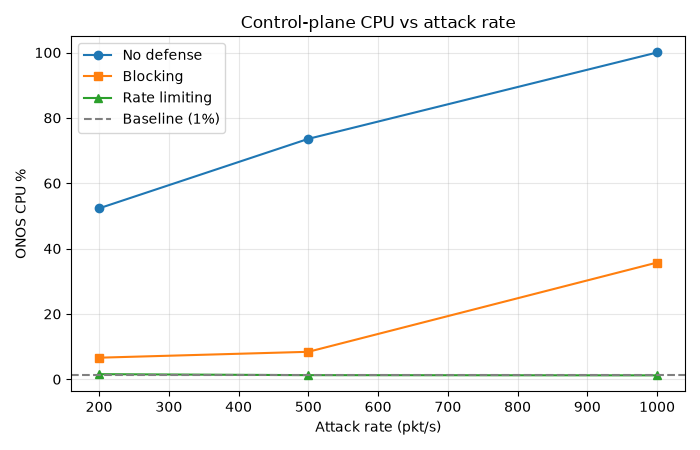
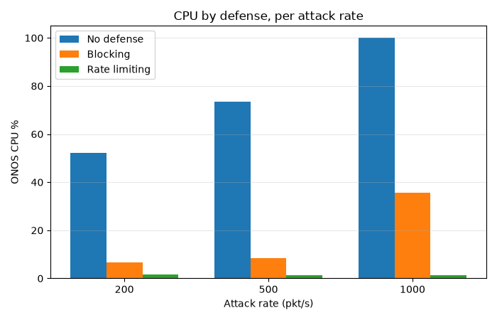
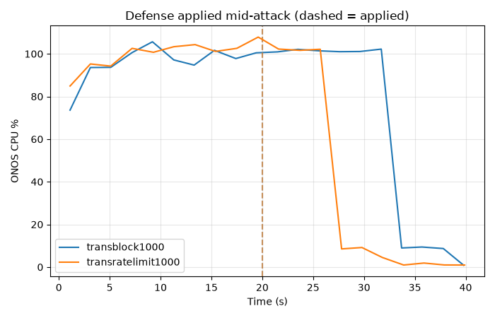
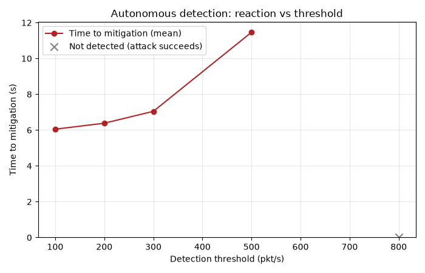

# SDN Controller Saturation Attacks (Group 2)

Implementation and analysis of a control-plane saturation attack (Packet-In
flooding) against a resource-limited ONOS controller, with two countermeasures,
port blocking and meter-based rate limiting, and an autonomous detector that
applies a mitigation on its own.

Course: Security of Software Defined Networking.

## Research question

As the Packet-In flooding rate rises against a CPU-limited ONOS controller, at
what rate does the controller start to degrade, what breaks first (CPU, RAM,
control-plane responsiveness or data-plane latency), and how do blocking and
rate limiting compare at reducing the impact without harming legitimate traffic?

## Threat model

An attacker controls one host already inside the network. From it, the attacker
floods the switch with packets whose source MAC and IP are random and change on
every packet. The switch has no matching flow rule for any of them, so it sends
a Packet-In to ONOS for each one. At a high enough rate the controller's CPU
saturates and it can no longer serve the rest of the network. No link is
overloaded; only table misses are generated. We study control-plane resource
exhaustion only.

## Topology

```
         ONOS (Docker, CPU-limited)
                |  OpenFlow 1.3 (tcp/6653)
             [ s1 ]  Open vSwitch
            /   |   \
         h1    h2    h3
      server  client  attacker
      (port1)  (port2)  (port3 = s1-eth3)
```

h1 is a server, h2 the legitimate client we measure (steady ping RTT and loss),
and h3 the attacker running the Scapy flood.

## Repository layout

| File | Role |
|------|------|
| `start_onos.sh` | Launch a **CPU-limited** ONOS in Docker, activate and **verify** `openflow` + `fwd`. |
| `topology.py` | Mininet network (h1/h2/h3 + s1), for the live demo. |
| `flood.py` | Scapy attack: random src MAC/IP → one Packet-In per packet. Runs in h3. |
| `legit.py` | Victim workload in h2: steady ping RTT + loss. |
| `monitor.py` | Samples ONOS CPU%, RAM, container memory and REST-API latency to CSV. |
| `block.py` | Countermeasure 1 — DROP everything from the attacker's ingress port. |
| `ratelimit.py` | Countermeasure 2 — cap the attacker's port to N pkt/s with an ONOS meter. |
| `detector.py` | Autonomous detector: watches per-port rates and triggers a mitigation by itself. |
| `eval_detection.py` | Sweeps detection thresholds and logs the detector's reaction time. |
| `onoslib.py` | Tiny ONOS REST helper (stdlib only). |
| `run_experiment.py` | Automated driver: waits for ONOS, then runs all scenarios and repetitions. |
| `plot.py` | Builds `summary.csv` and the attack/defense figures. |
| `plot_detection.py` | Turns `detection.csv` into the detection figure. |
| `requirements.txt` | Python dependencies for the driver/measurement side. |
| `results/` | Sample run, generated CSVs and figures. |

## Requirements

- Linux host with **root** access for Mininet.
- **Mininet ≥ 2.3** and **Open vSwitch** (`mn`, `ovs-vsctl`).
- **Docker** (or podman with the `docker` CLI).
- **Python 3.9+** and the packages in `requirements.txt`.

```bash
# Debian/Ubuntu
sudo apt install mininet openvswitch-switch python3-pip
# Fedora
sudo dnf install mininet openvswitch python3-pip

python3 -m pip install -r requirements.txt
```

The experiment scripts start `python3` processes inside the Mininet hosts and
in the monitor. Install the dependencies for the interpreter you use to run
the driver. A virtualenv also works: `run_experiment.py` propagates
`sys.executable` to every subprocess (monitor, legitimate client, flood,
defenses).

Two supported setups:

- system Python with Mininet **and** the pip packages installed system-wide;
- a venv that can see Mininet, e.g.
  `python3 -m venv --system-site-packages .venv && .venv/bin/pip install -r requirements.txt`,
  then run `sudo .venv/bin/python run_experiment.py ...` (Mininet still needs root).

## Quick start

```bash
./start_onos.sh

sudo python3 run_experiment.py --rates 200,500,1000 --duration 40 --reps 3

python3 plot.py
```

`start_onos.sh`:

1. starts a CPU/RAM-limited ONOS container (`CPU_LIMIT=1.0`, `MEM_LIMIT=2g`),
2. activates `openflow` and `fwd` at boot through `ONOS_APPS`,
3. waits for **HTTP 200** on `/onos/v1/devices` (a 404/503 is not "ready"),
4. verifies through the REST API that both applications are `ACTIVE`,
5. exits non-zero with the container logs if ONOS is not usable.

Useful variants:

```bash
CPU_LIMIT=0.5 ./start_onos.sh                  # more fragile controller
ONOS_APPS=openflow,fwd,gui2 ./start_onos.sh    # keep the web UI
ONOS_IMAGE=docker.io/onosproject/onos ./start_onos.sh   # podman short-name workaround
```

`run_experiment.py` refuses to start silently: it waits until ONOS sees the
switch, `org.onosproject.fwd` is `ACTIVE`, and the REST latency has settled,
and it stops if the flood or a defense script fails. Results from a previous
run are moved to `results/previous-<timestamp>/`; use `--append` to append
instead. The driver runs `sudo`, so it writes `results/` as root; run
`sudo chown -R $USER:$USER results` before plotting if needed.

### Smoke test (about 3 minutes)

A short run checks the whole chain without waiting for the full sweep:

```bash
sudo python3 run_experiment.py --rates 500 --duration 15 --reps 1 --trans-rate 500 --trans-delay 8
python3 plot.py
```

## Reproducing the results (the real experiment)

`run_experiment.py` builds the Mininet network itself and runs every scenario:
baseline, then each attack rate with no defense, with blocking, and with rate
limiting. Defenses are applied from the start of each run so the average is a
clean defended state, each scenario is repeated three times, and two transition
runs apply the defense mid-attack for the time-series figure. The full run
takes about 20 minutes.

```bash
sudo python3 run_experiment.py --rates 200,500,1000 --duration 40 --reps 3 \
     --controller 127.0.0.1 --trans-rate 1000 --trans-delay 20
sudo chown -R $USER:$USER results      # run_experiment writes as root; take the files back
python3 plot.py
```

## Autonomous detection

`eval_detection.py` sweeps a set of thresholds against a fixed attack. For each
threshold it runs the attack and the detector together; the detector watches
per-port rates over a sliding window, and when a port crosses the threshold it
installs a mitigation and logs how long it took.

```bash
sudo python3 eval_detection.py --controller 127.0.0.1 --rate 500 --defense ratelimit --thresholds 100,200,300,500,800 --reps 3
python3 plot_detection.py
```

Each threshold is attacked `--reps` times; the plot averages the runs per
threshold and marks a threshold as detected when at least half the runs
triggered. After the sweep, `--fp-check` adds a control run with no attack at
all: a legitimate `ping -f` burst on the client host, to see whether the
detector can be lured into mitigating a well-behaved host (it can — see
Results).

To watch the detector react live instead, run it on its own and then start an
attack; the mitigation fires without any manual action:

```bash
python3 detector.py --defense ratelimit --threshold 300
# then, inside the Mininet CLI:
#   h3 python3 flood.py --iface h3-eth0 --dst-ip 10.0.0.1 --rate 500 --duration 120 &
```

Caveat: the rate the detector compares to the threshold is a time average over
its window (at least 6 s of a 10 s window), so while the attack ramps up the
averaged rate understates the instantaneous attack rate, and the logged
reaction time includes this window warm-up. The floor of a few seconds is set
by how often ONOS refreshes its port statistics plus that averaging window.

## Live demo (manual)

Start ONOS as above, then the network, and drive the attack and defenses by hand.

```bash
sudo python3 topology.py --controller 127.0.0.1
# in the Mininet CLI (run pingall twice; the first run pays the reactive flow setup):
#   pingall
#   pingall
#   h2 python3 legit.py --server 10.0.0.1 --scenario demo &
#   h3 python3 flood.py --iface h3-eth0 --dst-ip 10.0.0.1 --rate 500 --duration 120 &
# in a side terminal, watch the CPU:
#   sudo python3 monitor.py --name onos --scenario demo
# then apply a defense (attacker is port 3):
#   python3 ratelimit.py --port 3 --rate 150 --install     # /  --remove
#   python3 block.py --port 3 --install                    # /  --remove
```

Teardown:

```bash
sudo mn -c
sudo docker rm -f onos
```

## Countermeasures

- **Blocking** installs a high-priority DROP flow matching the attacker's
  ingress port, via the ONOS REST API (application id
  `org.saturation.block`). It removes the attack entirely, including any
  legitimate traffic that would share that port.
- **Rate limiting** creates an ONOS meter (`PKTS_PER_SEC`) and a flow matching
  the attacker's ingress port that applies the meter and then outputs `NORMAL`.
  The attacker keeps sending, but the controller only sees the allowed rate.
  Note that the `NORMAL` output also keeps the allowed packets entirely in the
  datapath, which is part of why the metered runs sit so close to the baseline.

Both scripts verify that the flow is visible in ONOS after installation and
raise an error otherwise. `run_experiment.py` removes the flows/meters between
scenarios.

### Fallback if the switch does not honour meters

`ratelimit.py` exits with an explicit message if ONOS/OVS cannot allocate a
meter. You can cap the attacker port in OVS instead. `ingress_policing_rate`
is in **kbit/s**, so for 1500-byte frames:

```bash
# ~1000 pkt/s -> 1000 * 1500 * 8 / 1000 = 12000 kbit/s
sudo ovs-vsctl set interface s1-eth3 ingress_policing_rate=12000
sudo ovs-vsctl set interface s1-eth3 ingress_policing_burst=0

# remove the cap
sudo ovs-vsctl set interface s1-eth3 ingress_policing_rate=0
```

This fallback is coarser than an ONOS meter and is not automated by the driver.

## Result files

| File | Content |
|------|---------|
| `results/onos.csv` | `ts,scenario,rep,elapsed,cpu_pct,mem_mb,mem_pct,rest_ms` |
| `results/legit.csv` | `ts,scenario,rep,elapsed,steady_rtt_ms,loss` |
| `results/events.csv` | Time (s) at which a defense was applied mid-attack (the nominal delay). |
| `results/detection.csv` | Per-threshold detector runs: triggered, detect/mitigate time, port, rate. |
| `results/summary.csv` | Per-scenario means (CPU, RAM, REST latency, RTT, loss). |
| `results/fig_*.png` | CPU curve/time series, defenses, REST latency, RTT, memory, transition, detection. |

`monitor.py` samples once per loop (the `docker stats` call makes the effective
interval 1–3 s). `legit.py` sends one ping per second. Both use
`time.monotonic()` for `elapsed`, so an NTP step cannot create negative or
duplicated time values. The raw flood output of each scenario is kept in
`results/flood_<scenario>_rep<N>.log`.

> **Docker vs podman:** Docker's `docker stats` reports CPU % relative to one
> core (100 % = 1 core), which is what the sample results use. Podman reports
> CPU % relative to **all host cores**; multiply its value by `nproc` to compare
> with Docker (and keep the same `CPU_LIMIT`). The REST latency, RTT and loss
> columns are unaffected.

## Measurements and interpretation

- The attack generates a Packet-In per packet because the source MAC/IP is
  random; `fwd` installs a new reactive flow each time.
- `legit.py` pings h1 from h2. Once the flow is established, the RTT stays low
  even when the controller is saturated (the data plane is separate); what
  degrades is the control plane: CPU, REST latency and the ability to install
  new flows. The victim's ping is primed once before each scenario, so the
  steady RTT measures the **established** flow, and a saturated controller
  mainly hurts traffic that needs *new* flows.
- `monitor.py` reads CPU and memory with `docker stats`, so it measures the
  container as limited by `CPU_LIMIT`/`MEM_LIMIT`.
- The expected qualitative result: CPU grows with the attack rate until
  saturation (~100 % of one core); blocking removes the load, rate-limiting
  bounds it while keeping the attacker's packets flowing.
- REST latency barely moves under load (ONOS serves it on separate threads), so
  we rely mostly on CPU, RAM and ping.
- Pure-Python Scapy tops out around 1 to 2k pkt/s; for higher rates use hping3.

## Troubleshooting

| Symptom | Cause / fix |
|---|---|
| `*** Mininet must run as root` | Run `run_experiment.py`/`topology.py` with `sudo`. |
| `No OpenFlow device yet` | ONOS is not ready, the switch is not connected, or `fwd` is not `ACTIVE`. Re-run `./start_onos.sh` and check its output. |
| `REST API not ready after 180s` | Slow first boot or port conflict. `docker logs onos \| tail -80`. |
| ONOS container fails with `short-name resolution` | podman: use `ONOS_IMAGE=docker.io/onosproject/onos ./start_onos.sh`. |
| 100 % loss in `legit.csv` | `ping` output is localised; this version forces `LC_ALL=C`. If it reappears, check the `ping` binary. |
| `could not get a meter id` | The switch does not support OF1.3 meters; use the OVS ingress-policing fallback above. |
| `fwd state=INSTALLED` | The app is installed but not active; `start_onos.sh` now waits and retries. |
| Hosts fail to ping after re-running the topology | Restart ONOS (`docker rm -f onos` then `./start_onos.sh`): stale host entries from a previous topology otherwise confuse the controller. |

## Results

Means over three repetitions (detection: three runs per threshold), on a one-CPU,
2 GB ONOS container.

| Scenario | ONOS CPU % | RAM (MB) | REST latency (ms) | Legit ping (ms) | Loss % |
|----------|-----------:|---------:|------------------:|----------------:|-------:|
| baseline      |   1.3 | 2031 |  5.2 | 0.09 | 0.0 |
| attack 200    |  52.3 | 2032 | 10.4 | 0.06 | 0.0 |
| attack 500    |  73.6 | 2034 | 10.6 | 0.06 | 0.0 |
| attack 1000   | 100.0 | 2034 | 42.5 | 0.06 | 0.0 |
| block 200     |   6.6 | 2033 |  5.3 | 0.06 | 0.0 |
| block 500     |   8.4 | 2034 |  5.9 | 0.06 | 0.0 |
| block 1000    |  35.7 | 2034 |  7.9 | 0.06 | 0.0 |
| ratelimit 200 |   1.6 | 2033 |  4.9 | 0.06 | 0.0 |
| ratelimit 500 |   1.3 | 2034 |  4.8 | 0.06 | 0.0 |
| ratelimit 1000|   1.2 | 2033 |  4.7 | 0.06 | 0.0 |

The control-plane CPU is what saturates: it climbs from 1.3% at rest to 52.3%,
73.6% and 100% (the full single-core quota) at 200, 500 and 1000 pkt/s. The REST
latency follows: 5.2 ms at rest against 42.5 ms (~8x) under the 1000 pkt/s
flood — even served on separate threads, control-plane responsiveness degrades
measurably under saturation. RAM stays near 2 GB throughout, so it is not the
bottleneck. The legitimate ping stays around 0.06 ms with no loss, because an
established flow is forwarded by the switch alone; what a Packet-In flood breaks
is the ability to set up *new* flows, which is exactly what it denies every
spoofed source it injects.

Both defenses protect the controller, and in steady state they bring it back to
the baseline: the rate-limited port stays at 1.2–1.6% CPU at every attack rate
(the meter caps what reaches the controller and the `NORMAL` output keeps even
the allowed packets in the datapath). The block averages (6.6%, 8.4%, 35.7%)
deserve a caveat: the scenarios run back to back, and the block run starts
while ONOS is still flushing the reactive state installed by the **preceding
attack run** — with only 3 s between scenarios, the bigger the preceding
attack, the longer the flush. The per-run time series (`fig_cpu_timeseries.png`)
shows it directly: `block1000` starts near 68% and decays to ~2% within 16–24 s,
i.e. blocking itself drops everything, the average is inflated by the tail of
the previous scenario, not by a weakness of the rule.







For the autonomous detector against a 500 pkt/s attack, three runs per
threshold, every reported mitigation verified as actually installed in ONOS
(`verified=1` in `detection.csv`): thresholds of 100, 200 and 300 pkt/s detect
and mitigate in about 6–7 seconds, 500 pkt/s in about 11.5 seconds, and
800 pkt/s never triggers, so the attack runs unchecked. A higher threshold is
crossed later, and one set above the attack rate misses the attack entirely.
The reaction time has a floor of a few seconds, set by how often ONOS refreshes
its port statistics plus the averaging window (the detector starts before the
attack, so the logged rate is a window average that ramps up).

A false-positive control run (`--fp-check`): a legitimate `ping -f` burst —
~22 000 pkt/s of established-flow traffic on one port — **does** trigger the
detector, because it keys on per-port packet rate rather than Packet-In rate.
High data-plane throughput from a well-behaved host is indistinguishable from
an attack at this level; a production version should watch the switch's
Packet-In counter (or control-plane CPU) instead.



Other figures in `results/`: `fig_cpu_timeseries.png`, `fig_defense_effectiveness.png`,
`fig_rest_latency.png`, `fig_ping_health.png`, `fig_memory.png`.

## Authors

Group 2, Security of SDN. Repository: https://github.com/teofoli-matteo/SDN_PROJECT
