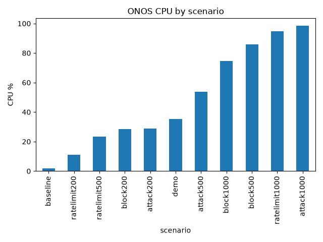
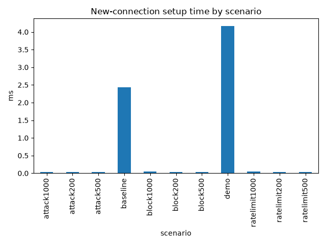

# SDN Controller Saturation Attacks — Group 2

Implementation and analysis of a **control-plane saturation attack** (Packet-In
flooding) against a resource-limited **ONOS** controller, plus two
countermeasures — **blocking** vs. **rate-limiting** — evaluated on their impact
and their effect on legitimate traffic.

> Course: *Security of Software Defined Networking*.

## Research question

As the Packet-In flooding rate increases against a CPU-limited ONOS controller,
**at what rate does the controller start to degrade, what breaks first**
(CPU, RAM, ping time, or new-connection setup time), and **how do blocking and
rate-limiting compare** at reducing the impact without harming legitimate
traffic?

## Threat model

- One malicious host inside the network sends a flood of packets with **fake,
  random source IP/MAC** addresses.
- Every packet looks like a brand-new flow, so the switch sends a new **Packet-In**
  to ONOS.
- At a high enough rate the ONOS CPU saturates and the control plane can no
  longer serve the network.
- We study **only control-plane (resource) saturation** — we do *not* flood the
  data links.

## Topology

```
          ONOS (Docker, CPU-limited)
                 |  OpenFlow 1.3 (tcp/6653)
              [ s1 ]  Open vSwitch
             /   |   \
          h1    h2    h3
       server  client  attacker
       (port1) (port2) (port3 = s1-eth3)
```

- **h1** — legitimate server. Owns an IP alias pool `10.0.0.101-250` so the
  prober can hit a *fresh* IP each time (= a brand-new flow).
- **h2** — legitimate client / flow-install prober (the victim we measure).
- **h3** — attacker, runs the Scapy flood.

## Repository layout

| File | Role |
|------|------|
| `start_onos.sh` | Launch a **CPU-limited** ONOS in Docker and activate `openflow` + `fwd` (reactive forwarding). |
| `topology.py` | Mininet network (h1/h2/h3 + s1), for the live demo. |
| `flood.py` | Scapy attack: random src MAC/IP → one Packet-In per packet. Runs in `h3`. |
| `legit.py` | Victim workload in `h2`: logs steady ping, new-connection setup time, loss. |
| `monitor.py` | Samples ONOS CPU%/RAM via `docker stats` → CSV. |
| `block.py` | Countermeasure 1 — DROP everything from the attacker's ingress port. |
| `ratelimit.py` | Countermeasure 2 — cap the attacker's port to N pkt/s with an ONOS meter. |
| `onoslib.py` | Tiny ONOS REST helper (stdlib only). |
| `run_experiment.py` | Automated driver → runs every scenario, writes `results/*.csv`. |
| `plot.py` | Turns the CSVs into `summary.csv` + two figures. |
| `results/` | Collected CSVs and generated figures. |

## Prerequisites

- Linux host with **Mininet + Open vSwitch**, **Docker**, **Python 3**, **Scapy**.
- `plot.py` additionally needs `pandas` + `matplotlib`.

```bash
sudo apt install -y mininet openvswitch-switch python3-scapy docker.io curl
pip install pandas matplotlib
docker pull onosproject/onos:2.7-latest
```

## Two design decisions (worth defending)

1. **Blocking is by ingress PORT, not source IP/MAC.** The attacker randomises
   its source on every packet, so there is no stable source address to match —
   the only stable identifier is the switch port the attacker sits on.
2. **Rate-limiting uses an ONOS meter** (the SDN-native way). If your OVS build
   does not honor OF1.3 meters, enforce the same cap in the datapath with OVS
   ingress policing (see *Known issues*). This is itself a useful finding about
   OVS meter support.

---

## How to run (live demo)

### 1. Start ONOS — **first**, and wait until it is fully ready
```bash
sudo mn -c
sudo ./start_onos.sh
```
**Checkpoint:** the REST API must answer (not 503) *and* the OpenFlow app must be
`ACTIVE`:
```bash
curl -u onos:rocks http://localhost:8181/onos/v1/devices           # -> {"devices":[]}
curl -s -u onos:rocks http://localhost:8181/onos/v1/applications/org.onosproject.openflow \
  | grep -o '"state":"[A-Z]*"'                                      # -> "ACTIVE"
```
If the state is `INSTALLED`, activate and wait:
```bash
curl -u onos:rocks -X POST http://localhost:8181/onos/v1/applications/org.onosproject.openflow/active
curl -u onos:rocks -X POST http://localhost:8181/onos/v1/applications/org.onosproject.fwd/active
sleep 10
```

### 2. Start the network — **only after** ONOS is ready
```bash
sudo python3 topology.py --controller 127.0.0.1
```
**Checkpoint:** the switch must be connected, and forwarding must work:
```
mininet> sh curl -s -u onos:rocks http://localhost:8181/onos/v1/devices   # of:0000000000000001
mininet> pingall                                                          # 0% dropped
```

### 3. Observe + attack
Side terminal (controller CPU, your main screen):
```bash
sudo python3 monitor.py --name onos --scenario demo
```
In the Mininet CLI (`&` keeps the prompt free so both run in parallel):
```
mininet> h2 python3 legit.py --server 10.0.0.1 --scenario demo &
mininet> h3 python3 flood.py --iface h3-eth0 --dst-ip 10.0.0.1 --rate 500 --duration 120 &
```
Watch ONOS CPU climb and `newconn_ms` balloon while `steady_rtt_ms` stays low —
**only the control plane is hit.** Follow the victim live:
```bash
tail -f results/legit.csv
```

### 4. Apply the countermeasures (attacker = port 3)
```bash
# Defense 1 — full block of the attacker's port
python3 block.py --port 3 --install
python3 block.py --port 3 --remove

# Defense 2 — rate limiting (ONOS meter)
python3 ratelimit.py --port 3 --rate 150 --install
python3 ratelimit.py --port 3 --remove
```

### 5. Teardown
```
mininet> h2 pkill -f legit.py
mininet> exit
```
```bash
sudo mn -c
sudo docker rm -f onos
```

---

## Reproducing the data (for the report)

With ONOS up, instead of the manual steps:
```bash
sudo python3 run_experiment.py --controller 127.0.0.1 --rates 200,500,1000 \
     --duration 40 --defense-delay 15
python3 plot.py
```
Outputs in `results/`: `summary.csv`, `fig_cpu.png`, `fig_newconn.png`.

### Metrics collected
- **ONOS CPU % / RAM** — what saturates first (`monitor.py`).
- **new-connection setup time** — what users feel first (`legit.py`, fresh-alias ping).
- **steady ping RTT** — data-plane health; stays flat (`legit.py`).
- **legit loss %** — false positives caused by a defense (`legit.py`).

## Results

ONOS CPU per scenario — the attack drives the control plane up; both defenses
bring it back down:



New-connection setup time per scenario — this is what legitimate users feel
first under the attack, and what the defenses restore:



<!-- Add your own demo screenshots like this:

-->

### Summary table

Mean values per scenario (replace with your own numbers from
[`results/summary.csv`](results/summary.csv)):

| Scenario | ONOS CPU % | New-conn setup (ms) | Legit loss % |
|----------|-----------:|--------------------:|-------------:|
| baseline        |  … |  … | … |
| attack 200      |  … |  … | … |
| attack 500      |  … |  … | … |
| attack 1000     |  … |  … | … |
| block 500       |  … |  … | … |
| ratelimit 500   |  … |  … | … |

### Raw data

- [`results/summary.csv`](results/summary.csv) — mean per scenario (the table above).
- [`results/onos.csv`](results/onos.csv) — ONOS CPU/RAM samples over time.
- [`results/legit.csv`](results/legit.csv) — victim ping / new-connection / loss samples.

## Known issues / notes

- **Order matters:** start ONOS and wait until `/devices` stops returning 503 and
  the `openflow` app is `ACTIVE` *before* launching Mininet. Otherwise the switch
  connects to a half-booted controller and never registers.
- **OVS meters:** some OVS builds do not honor OF1.3 meters. If `ratelimit.py`
  reports it cannot get a meter id, enforce the cap in the datapath instead:
  ```bash
  sudo ovs-vsctl set interface s1-eth3 ingress_policing_rate=1000
  sudo ovs-vsctl set interface s1-eth3 ingress_policing_burst=100
  # remove:
  sudo ovs-vsctl set interface s1-eth3 ingress_policing_rate=0
  ```
- **Attack rate:** pure-Scapy sending tops out around 1–2k pkt/s in Python; for
  higher rates use a tool like `hping3`.

## Authors

Group 2 — *Security of SDN*.
